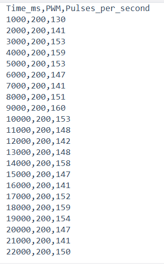

# Applying PID Control to the Micromouse Drive Motor

## 1. Introduction

This section presents the application of motor speed control to the Micromouse project. The main objective was to study the relationship between the PWM input and motor speed using encoder feedback.

The experiment was performed using an Arduino Uno, an L293D motor driver, and a DC motor with an encoder. Different PWM values were applied, and the encoder readings were collected to estimate the motor parameters, K and τ.

## 2. Simulation Environment

We used **Tinkercad Circuits** to build and test the motor control circuit.

Tinkercad was selected because it provides a practical environment for building Arduino circuits and testing electronic components without requiring immediate access to physical hardware.

It allowed us to:
- Build and test the Arduino and motor driver connections.
- Control the motor using PWM signals.
- Connect the encoder and monitor its pulse readings.
- Perform repeated tests under different PWM settings.

Our goal was to follow the expected experimental procedure as closely as possible within the available simulation environment.

Although physical hardware would provide more realistic measurements, Tinkercad allowed us to implement the control concept and investigate the motor response.

The simulation may not reproduce every physical effect, such as actual mechanical load, friction, electrical noise, and hardware variations.

## 3. Circuit Configuration

The circuit consists of:

- Arduino Uno.
- L293D motor driver.
- DC motor with encoder.
- External DC power supply.
- Encoder feedback connections.

The Arduino pins were configured as follows:

| Function | Arduino Pin |
|---|---|
| Motor Direction | D7 |
| Motor PWM | D9 |
| Motor Enable | D8 |
| Encoder Channel A | D2 |

The encoder feedback was used to measure motor rotation by counting pulses.

### Circuit Diagram


## 4. Experimental Procedure

Two different PWM settings were tested to investigate the relationship between the input signal and motor speed.

**Test 1: PWM = 100**

The motor was operated at a PWM value of 100, and encoder pulses were recorded over time.

**Test 2: PWM = 200**

The PWM value was increased to 200, and another set of encoder measurements was collected.

The Arduino Serial Monitor was used to record the measurements in pulses per second.

## 5. Experimental Results

### 5.1 Test 1 – PWM = 100

The recorded measurements showed an average speed of approximately 48.23 pulses per second.


### 5.2 Test 2 – PWM = 200

After increasing the PWM command to 200, the average measured speed increased to approximately 148.86 pulses per second.



### 5.3 Results Comparison

| Parameter | PWM = 100 | PWM = 200 |
|---|---:|---:|
| Average Speed (pulses/s) | 48.23 | 148.86 |
| Minimum Speed (pulses/s) | 36 | 130 |
| Maximum Speed (pulses/s) | 62 | 160 |

The measurements indicate that the average encoder pulse rate increased when the PWM command was increased.

Some variations were observed between consecutive measurements.

## 6. Estimation of Motor Parameters

The experimental measurements were used to estimate the parameters of a first-order motor model.

The general transfer function is:

```text
G(s) = K / (τs + 1)
```

Where:
- K is the process gain.
- τ is the time constant.
- s is the Laplace variable.

### 6.1 Process Gain (K)

The process gain represents the change in motor speed relative to the change in PWM input.

The calculation is:

```text
K = Change in Speed / Change in PWM
```

Using the average measured speeds:

```text
K = (148.86 - 48.23) / (200 - 100)

K = 100.63 / 100

K ≈ 1.01
```

Therefore, the estimated process gain is:

**K ≈ 1.01 pulses/s per PWM unit.**

### 6.2 Time Constant (τ)

The time constant describes how quickly the motor response approaches its final value after a change in the input.

For a first-order system, the time constant is the time required to reach approximately 63.2% of the total response change.

The approximate calculation uses:

```text
y(τ) = Initial Speed + 0.632 ×
       (Final Speed - Initial Speed)
```

Based on the available transient measurements, the response showed a rapid change during the first sampling intervals after the PWM step.

An approximate time constant was considered:

```text
τ ≈ 0.10 seconds
```

This value is preliminary because the initial transient readings showed variations compared with the steady-state measurements. The sampling process and limitations of the simulation environment may have affected the observed response.

Further testing with physical hardware or additional simulation measurements would help improve this estimate.

### 6.3 Preliminary Motor Model

Using the estimated parameters:

```text
K = 1.01
τ = 0.10 s
```

The preliminary first-order model is:

```text
G(s) = 1.01 / (0.10s + 1)
```

This model provides an initial approximation based on the available simulation measurements.

## 7. Challenges and Limitations

During the experiment, we encountered several challenges:

- Encoder readings showed variations between consecutive measurements.
- Some initial transient readings differed from the steady-state measurements.
- The simulated motor response did not always follow a perfectly smooth first-order behavior.
- Tinkercad provides an approximation of the motor and encoder behavior rather than measurements from physical hardware.

Despite these challenges, we were able to build the circuit, test different PWM values, collect encoder measurements, and obtain preliminary estimates of the motor parameters.

The experience also helped us understand the importance of encoder feedback, sampling time, and measurement consistency when modeling a motor system.

## 8. Conclusion

In this experiment, we implemented a simulated Micromouse motor control setup using an Arduino Uno, an L293D motor driver, and a DC motor with an encoder.

We tested two PWM levels and observed an increase in the average encoder pulse rate when the PWM command increased from 100 to 200.

The collected measurements were used to estimate the process gain and obtain a preliminary time-constant value.

Although some measurement variations were observed, the experiment provided practical experience in motor speed measurement, encoder feedback, PWM control, and first-order system modeling.

These estimated parameters provide a starting point for the PID controller design in the next stage of the project.
