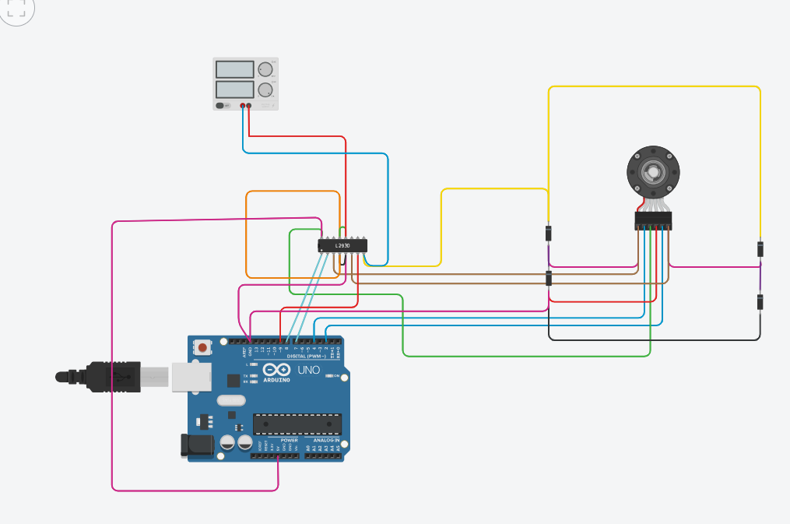
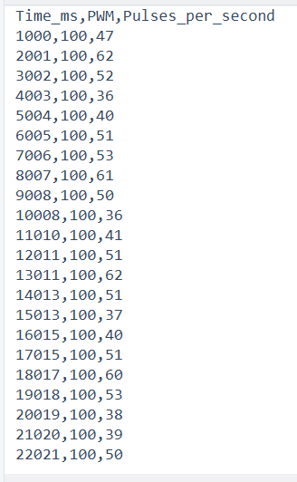

# Applying PID Control to the Micromouse Drive Motor

## 1. Introduction

This section presents the application of the PID control project to the Micromouse drive motor. The main objective was to study the relationship between the PWM input and motor speed using encoder feedback.

We used an Arduino Uno, an L293D motor driver, and a DC motor with an encoder. The experiment focused on collecting encoder pulse readings at different PWM values and using them to estimate the motor parameters, K and τ.

## 2. Simulation Environment

We used **Tinkercad Circuits** to build and test the motor control circuit.

Tinkercad was selected as a practical simulation environment that allowed us to:
- Build the Arduino and motor driver connections.
- Test the motor direction and PWM control.
- Connect the encoder signals and monitor pulse readings.
- Repeat tests under controlled conditions.

We tried to follow the same general arrangement and testing procedure expected in the actual hardware experiment.

Although a physical motor setup would provide more realistic measurements, Tinkercad allowed us to implement and investigate the control concept in a virtual environment.

It is important to note that simulated results may differ from real motor behavior because the simulator does not reproduce every physical effect, such as actual mechanical load, friction, electrical noise, and hardware variations.

## 3. Circuit Configuration

The circuit consists of:

- Arduino Uno.
- L293D motor driver.
- DC motor with encoder.
- External DC power supply.
- Encoder feedback connections.

The Arduino was configured with the following pins:

| Function | Arduino Pin |
|---|---|
| Motor Direction | D7 |
| Motor PWM | D9 |
| Motor Enable | D8 |
| Encoder Channel A | D2 |

The encoder feedback was used to measure motor rotation through pulse counting.

### Circuit Diagram

## 4. Experimental Procedure

The experiment was performed using two different PWM settings.

**Test 1: PWM = 100**

The motor was operated with a PWM command of 100, and encoder pulses were recorded over time.

**Test 2: PWM = 200**

The PWM command was increased to 200, and the encoder readings were collected again.

The results were monitored using the Arduino Serial Monitor.

The objective was to compare the motor speed at the two input levels and observe how the encoder measurements changed.

## 5. Experimental Results

### Test 1 – PWM = 100

The recorded measurements showed an average speed of approximately 48.23 pulses per second.

### Test 2 – PWM = 200

After increasing the PWM command to 200, the average measured speed increased to approximately 149.24 pulses per second.

### Results Comparison

| Parameter | PWM = 100 | PWM = 200 |
|---|---:|---:|
| Average Speed (pulses/s) | 48.23 | 149.24 |
| Minimum Recorded Speed | 36 | 130 |
| Maximum Recorded Speed | 62 | 160 |

The measurements show an increase in the average encoder pulse rate when the PWM command was increased.

Some fluctuations were observed during both tests.

## 6. Estimation of Motor Parameters

The experimental measurements were used to estimate the parameters of a first-order motor model:

\[
G(s)=\frac{K}{\tau s+1}
\]

### 6.1 Process Gain (K)

The process gain represents the change in motor speed relative to the change in PWM input.

\[
K=\frac{\Delta Speed}{\Delta PWM}
\]

Using the average measured speeds:

\[
K=\frac{149.24-48.23}{200-100}
\]

\[
\boxed{K\approx1.01}
\]

Therefore, the estimated process gain is approximately 1.01 pulses/s per PWM unit.

### 6.2 Time Constant (τ)

The time constant describes how quickly the motor response approaches its final value after a change in the input.

For a first-order system, the time constant corresponds to the time required to reach approximately 63.2% of the total response change.

Based on the available transient measurements, an approximate value was considered:

\[
\boxed{\tau\approx0.10\text{ s}}
\]

This value is preliminary because some initial encoder readings during the transition differed considerably from the steady-state measurements.

The difference may be related to pulse-counting behavior, sampling timing, or the limitations of the simulated motor and encoder model.

Therefore, additional testing would be required to obtain a more consistent time-constant measurement.

### 6.3 Preliminary Plant Model

Using the estimated parameters:

\[
\boxed{G(s)=\frac{1.01}{0.10s+1}}
\]

This model provides an initial approximation of the motor behavior based on the collected simulation results.

## 7. Challenges and Limitations

During the experiment, we faced several challenges:

- The encoder readings showed fluctuations between consecutive measurements.
- Some initial readings during the PWM transition differed from the steady-state measurements.
- The simulated response did not always follow the expected smooth first-order behavior.
- The Tinkercad environment provides an approximation of the motor and encoder behavior rather than measurements from a physical motor.

Despite these limitations, we were able to establish the circuit, test different PWM commands, collect encoder measurements, and obtain preliminary estimates of the motor parameters.

Further testing with physical hardware would help validate the estimated model and improve the accuracy of the measurements.

## 8. Conclusion

In this experiment, we implemented a simulated Micromouse motor control setup using Arduino Uno, an L293D motor driver, and an encoder-equipped DC motor.

We tested two PWM levels and observed an increase in the average encoder pulse rate when the PWM command increased from 100 to 200.

Using the collected measurements, we estimated the process gain and obtained a preliminary time-constant estimate.

Although some measurement variations were observed, the experiment provided an opportunity to apply motor speed measurement, encoder feedback, and first-order system modeling.

These preliminary results provide a starting point for the PID controller design in the next stage.
