# P1 – PID Playground

**ENCS4380 Interfacing Techniques · Homework 2**  
**Developed by:** Aseel Nakhleh (1230736)  
**Team:** Sparky  
**Birzeit University**

## Overview

The PID Playground is an interactive web-based simulation that demonstrates how proportional (Kp), integral (Ki), and derivative (Kd) gains affect the behavior of a closed-loop control system.

Users can adjust the controller and plant parameters, observe the system response, and analyze performance metrics. The module also includes a feedback block diagram, control signal visualization, prediction activity, and validation checks.

## Features

- **Plant Selection:** Choose between first-order and second-order systems.
- **Adjustable Plant Parameters:** Change plant gain, time constant, natural frequency, and damping ratio.
- **PID Controller:** Adjust Kp, Ki, Kd, and the setpoint.
- **Closed-Loop Block Diagram:** Visualize the PID controller, plant, and negative feedback path.
- **Step Response:** Compare the actual system output with the desired setpoint.
- **Control Signal:** Display the controller output and its saturation limits.
- **Performance Metrics:** Calculate rise time, overshoot, settling time, and steady-state error.
- **Predict, Then Check:** Predict the effect of increasing Ki and compare the prediction with the simulated response.
- **Validation Tests:** Check the controller calculations against the homework's expected results.

## Mathematical Model

### First-Order Plant

The first-order system is represented by:

$$
G(s) = \frac{K}{\tau s + 1}
$$

where:

- $K$ is the plant gain.
- $\tau$ is the time constant.

### Second-Order Plant

The second-order system is represented by:

$$
G(s) = \frac{K\omega_n^2}{s^2 + 2\zeta\omega_n s + \omega_n^2}
$$

where:

- $\omega_n$ is the natural frequency.
- $\zeta$ is the damping ratio.

### PID Controller

The PID control law is:

$$
u(t) = K_p e(t) + K_i \int_0^t e(\lambda)\,d\lambda + K_d \frac{de(t)}{dt}
$$

where:

- $u(t)$ is the control signal.
- $e(t)$ is the difference between the setpoint and system output.
- $K_p$ is the proportional gain.
- $K_i$ is the integral gain.
- $K_d$ is the derivative gain.

The simulation uses the Euler numerical method to calculate the closed-loop response over time.
## Run Locally

1. Download or clone the GitHub repository.
2. Open the `Homework2/AseelNakhleh1230736_P1` folder.
3. Keep the following files in the same directory:
   - `P1.html`
   - `P1.css`
   - `P1.js`
4. Open `P1.html` in a web browser.

An internet connection is required to load the Plotly graphing library.

## Validation Tests

The validation checks use a first-order plant with \(K = 1\) and \(\tau = 1\) second.

| Test | Expected | Calculated | Status |
|---|---|---|---|
| P-only Time Constant (Kp = 9) | 0.100 s | 0.0995 s | PASS |
| P-only Steady-State Error (Kp = 9) | 10.0% | 10.00% | PASS |
| PI Natural Frequency (Kp = 1, Ki = 1) | 1.000 rad/s | 1.000 rad/s | PASS |
| PI Damping Ratio (Kp = 1, Ki = 1) | 1.000 | 1.000 | PASS |
| PI Steady-State Error | Approximately 0 | 0.000000 | PASS |

The time constant and steady-state errors are checked using numerical simulation results. Natural frequency and damping ratio are calculated from the closed-loop model equations.

## Screenshots

### 1. PID Controller Parameters

The user can adjust the plant parameters, PID gains, and setpoint.

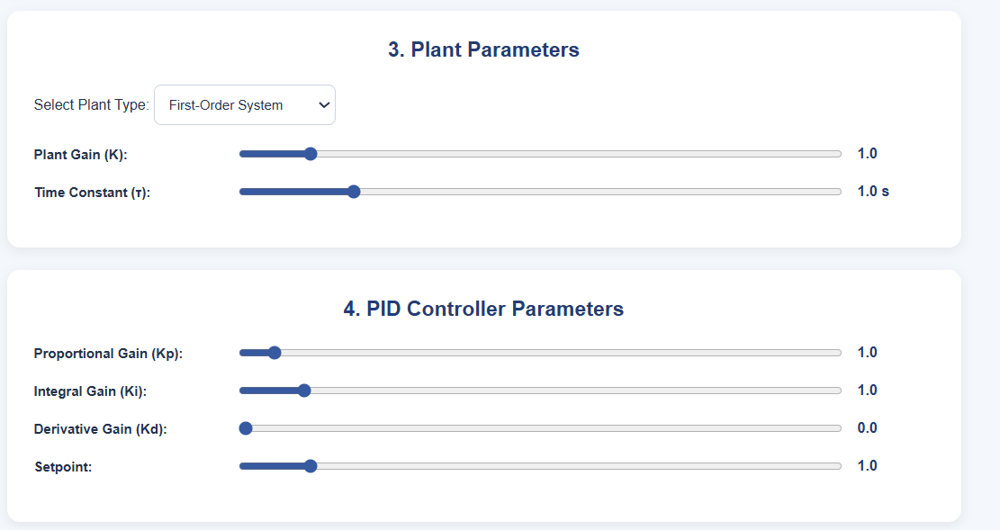

### 2. Closed-Loop Block Diagram

The diagram illustrates the PID controller, plant, and negative feedback path.

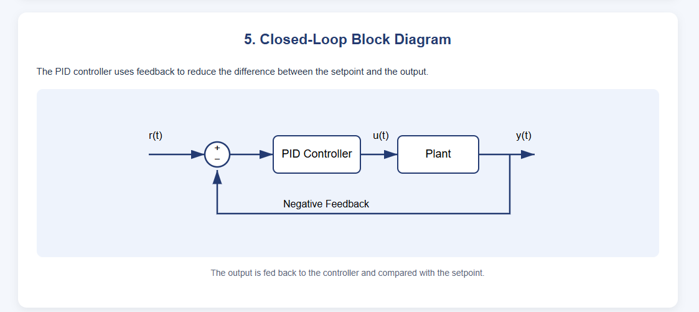

### 3. Closed-Loop Step Response

The graph compares the system output with the desired setpoint.

### 4. Control Signal

The plot displays the control signal and its upper and lower saturation limits.

### 5. Performance Metrics

The simulation displays rise time, overshoot, settling time, and steady-state error.

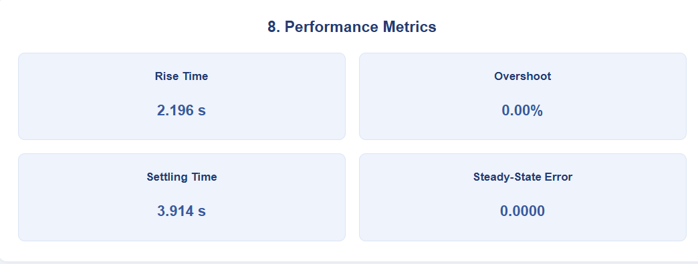

### 6. Validation Tests

The validation table compares expected and calculated results.

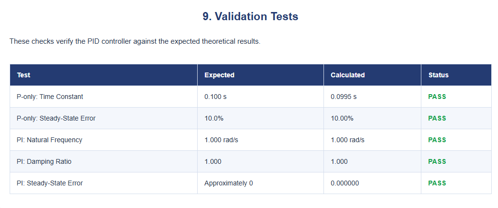

### 7. Predict, Then Check

Users predict how increasing Ki affects the steady-state error and compare their answer with the simulated result.

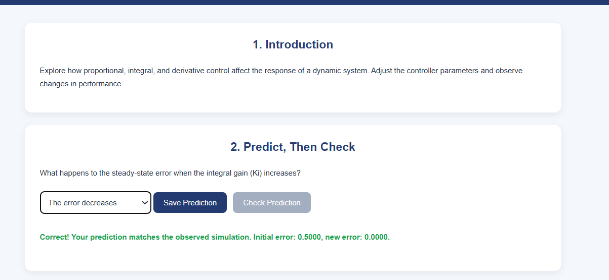

## Functional Testing

The PID Playground was tested using different controller parameters to observe changes in system response and performance.

### Test 1: P-Only Controller (Kp = 1)

For a first-order plant with K = 1 and τ = 1 s, the controller uses Kp = 1, Ki = 0, and Kd = 0.

The expected steady-state output is approximately 0.5, with a steady-state error of 0.5.

**Controller Parameters**

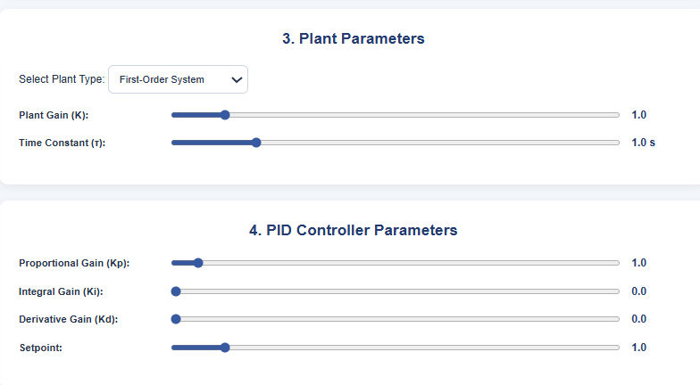

**Closed-Loop Step Response**

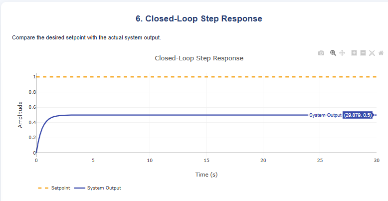

**Performance Metrics**

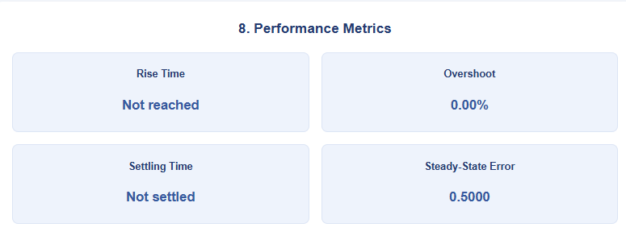

### Test 2: P-Only Controller (Kp = 9)

For Kp = 9, Ki = 0, and Kd = 0, the system is expected to respond faster.

The expected steady-state output is approximately 0.9, with a steady-state error of 0.1.

**Controller Parameters**

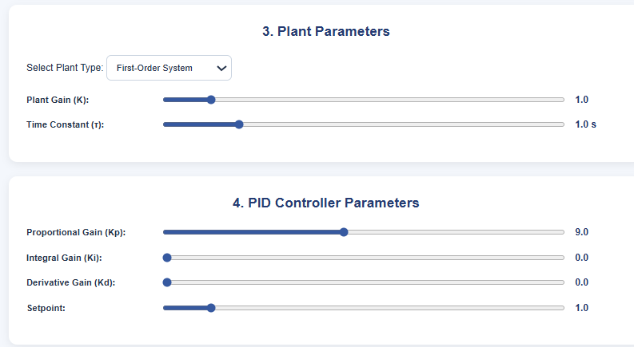

**Closed-Loop Step Response**

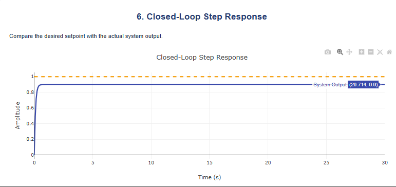

**Performance Metrics**

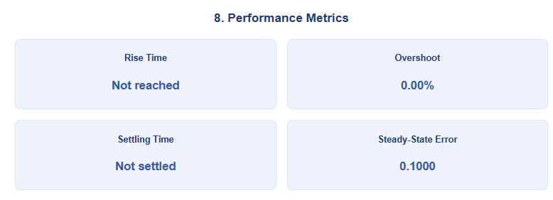

### Test 3: PI Controller (Kp = 1, Ki = 1)

For Kp = 1, Ki = 1, and Kd = 0, the integral term eliminates the steady-state error for the stable first-order system.

The expected steady-state output is approximately 1, with a steady-state error approaching zero.

**Controller Parameters**

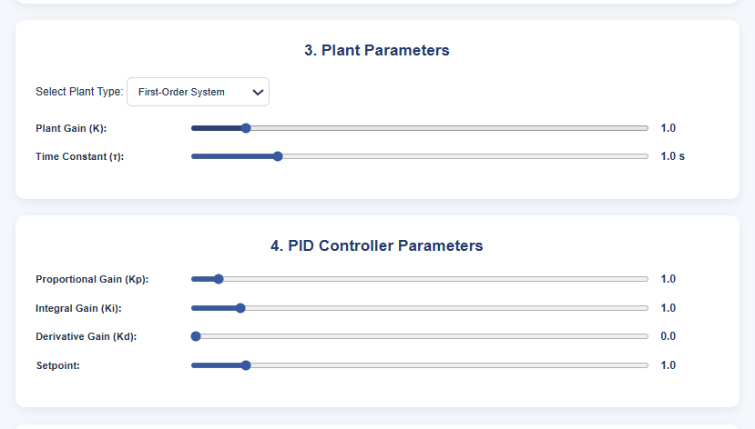

**Closed-Loop Step Response**

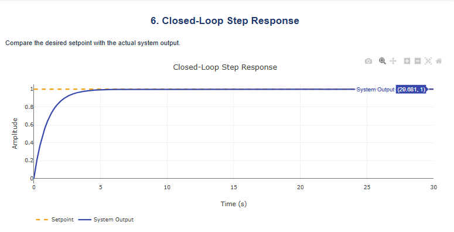

**Performance Metrics**

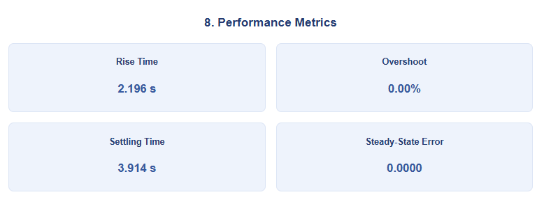

### Test 4: Second-Order System

The second-order plant was tested by changing the natural frequency and damping ratio while observing changes in the system response.

**System Parameters**

**Closed-Loop Step Response**

**Performance Metrics**

## Live Website

The PID Playground is part of the Team Sparky PID Control Toolkit.

**P1 Module:** [Open PID Playground](https://aseelnakhleh.github.io/encs4380-dynamics-sparky/Homework2/AseelNakhleh1230736_P1/P1.html)

**Main Website:** [Team Sparky Interactive Toolkit](https://aseelnakhleh.github.io/encs4380-dynamics-sparky/)

## AI Assistance

AI tools were used to help understand PID control concepts and clarify theoretical ideas related to the module also helping the developer with implementing the code. 
