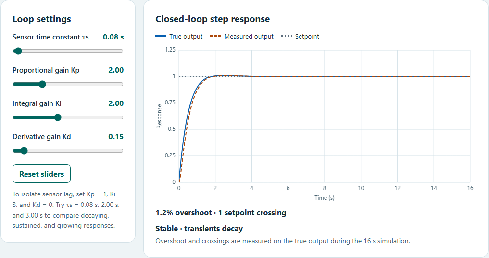
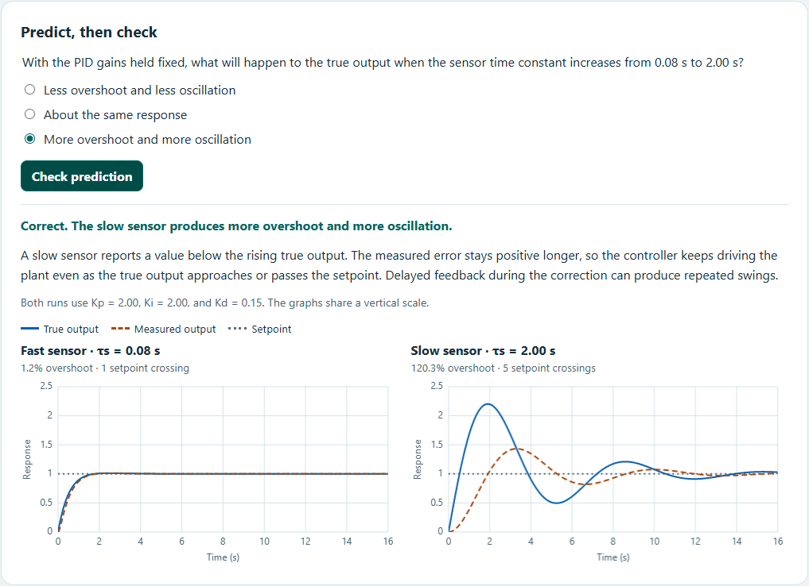
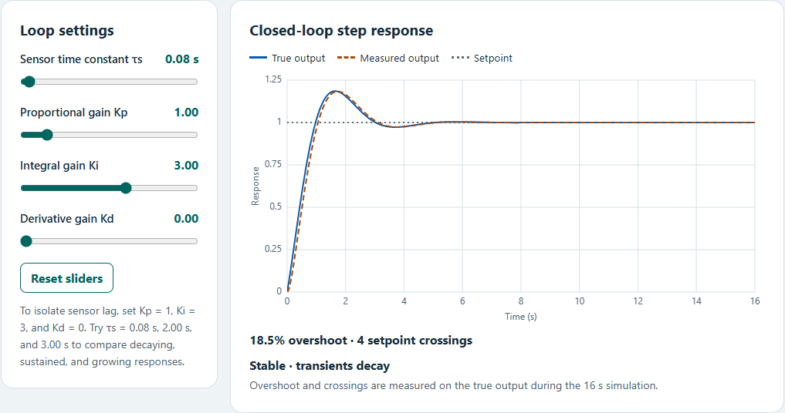
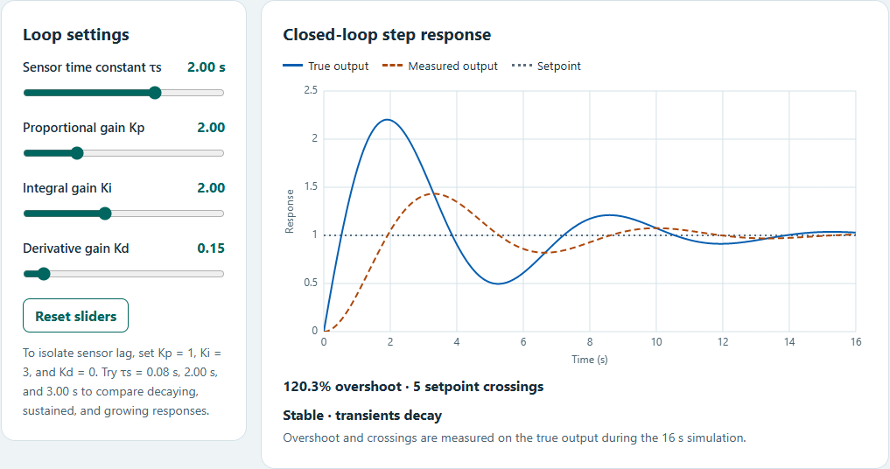
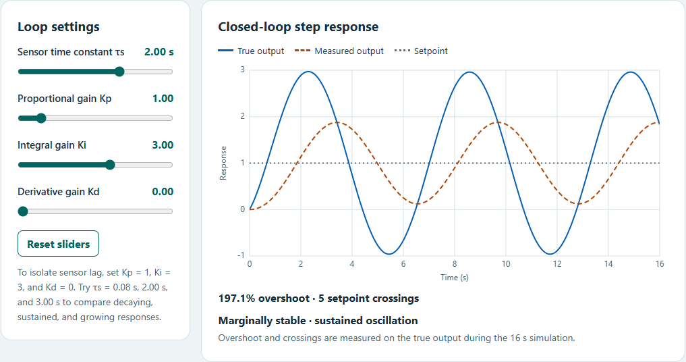
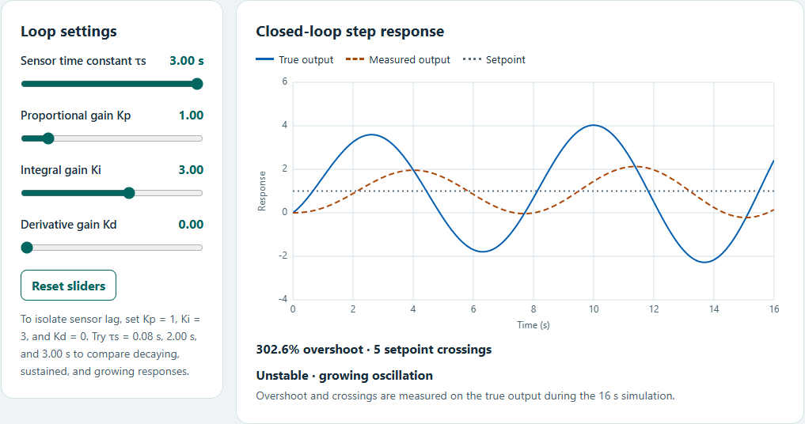
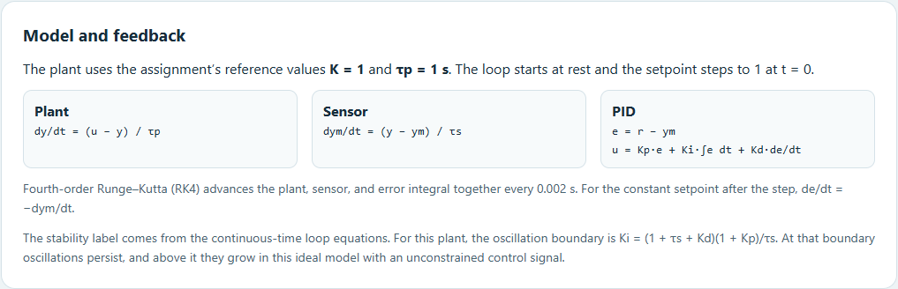

# P2 – A Slow Sensor in the Loop

**ENCS4380 Interfacing Techniques · Homework 2** 
**Developed by:** Hala Tarifi (1230624) 
**Team:** Sparky 
**Birzeit University**

## Overview

A Slow Sensor in the Loop is an interactive simulation of a PID controller that receives feedback from a first-order sensor. The graph shows the true plant output, measured sensor output, and setpoint together so you can see the difference between what the plant is doing and what the controller sees.

When the sensor responds slowly, it can report a value below the rising plant output. The controller continues to drive the plant while the measured error stays positive. Depending on the gains and sensor time constant, the resulting overshoot can be followed by decaying, sustained, or growing oscillations.

## Features

- **Sensor and PID sliders** adjust the sensor time constant from 0.02 to 3.00 s, proportional gain from 0 to 8, integral gain from 0 to 5, and derivative gain from 0 to 2.
- **Live step response** plots the true output, measured output, and unit setpoint over 16 seconds.
- **Response metrics** report true-output overshoot and setpoint crossings. The crossing counter ignores differences within 0.0001 of the setpoint to avoid counting negligible fluctuations.
- **Stability readout** classifies the continuous-time loop as stable, marginally stable, or unstable.
- **Predict, Then Check** asks for a prediction before revealing two responses at fixed gains and on a shared vertical scale.
- **Reset and responsive layout** restore the default settings and stack controls and plots on narrow screens.

## Mathematical Model

### First-Order Plant

The plant has transfer function $G_p(s)=K/(\tau_p s+1)$. The implementation uses $K=1$ and $\tau_p=1\,\mathrm{s}$.

$$
\frac{dy}{dt}=\frac{Ku-y}{\tau_p}
$$

Here $u$ is the controller output and $y$ is the true plant output.

### First-Order Sensor

The sensor has transfer function $G_s(s)=1/(\tau_s s+1)$ and reports the measured output $y_m$.

$$
\frac{dy_m}{dt}=\frac{y-y_m}{\tau_s}
$$

Increasing $\tau_s$ makes the measured output respond more slowly to changes in the true output.

### PID Controller

The negative feedback path uses $y_m$ to calculate the error $e=r-y_m$. The simulation starts at rest with zero accumulated error and applies a unit step at $t=0$.

$$
u=K_p e+K_i I+K_d\frac{de}{dt},
\qquad \frac{dI}{dt}=e
$$

The setpoint is constant after the step, so the implementation evaluates $de/dt=-dy_m/dt$. The model uses an unconstrained control signal.

### RK4 Numerical Method

Fourth-order Runge–Kutta advances the three states ($y$, $y_m$, and $I$) together in steps of 0.002 s. Each step evaluates the coupled derivatives at the start, two midpoint estimates, and the end, then combines them with weights $1,2,2,1$ divided by six. The graph retains every fifth state, giving a plotted sample interval of 0.01 s. Overshoot and crossing counts use the full solver resolution.

### Stability Boundary

For positive integral gain, the normalized plant gives the characteristic polynomial

$$
\tau_s s^3+(1+\tau_s+K_d)s^2+(1+K_p)s+K_i.
$$

The continuous-time boundary occurs at $K_i=(1+\tau_s+K_d)(1+K_p)/\tau_s$. At that value an oscillatory mode persists after the decaying transient. Above it, the oscillations grow in the ideal model. With zero integral gain, the proportional–derivative loop is stable over the slider ranges but can have steady-state error.

## Run Locally

1. Download or clone the team repository.
2. Open `Homework2/HalaTarifi1230624_P2`.
3. Keep `index.html`, `style.css`, and `script.js` in that folder.
4. Open [index.html](index.html) in a web browser.

The module runs offline without a server, build step, or external graphing library.

## Validation Tests

The numerical checks below exercise the simulation code with the same plant constants as the webpage. The zero-gain, P-only, and PI endpoint checks were rerun in Chrome for this README. The range and accuracy checks were run in the earlier numerical review against the same P2 implementation.

| Test | Expected | Calculated or observed | Status |
|---|---|---|---|
| Zero gains, $\tau_s=0.02$ s | Both outputs stay at zero | Both outputs were zero at 16 s, and the numerical review verified the full trace | Pass |
| P-only, $K_p=2$, $\tau_s=0.08$ s | Both outputs approach $2/3$ | Both outputs were 0.666667 at 16 s, rounded to six decimal places | Pass |
| PI, $K_p=1$, $K_i=1$, $\tau_s=0.08$ s | Both outputs approach 1 | Both outputs were within $3\times10^{-8}$ of 1 at 16 s | Pass |
| Sustained case, $K_p=1$, $K_i=3$, $K_d=0$, $\tau_s=2$ s | True output agrees with the continuous-time solution | Maximum absolute difference below $4\times10^{-12}$ at plotted times | Pass |
| Slider-range sweep | Finite true and measured outputs over 16 s | 7,713 configurations passed, including every value of each slider with the other three at their endpoint combinations, plus mixed and boundary cases | Pass |
| Step-size check | Halving the RK4 step produces close traces | In 165 configurations, the maximum difference divided by the larger of 1 or the reference magnitude was below $10^{-6}$ | Pass |

## Screenshots

These PNGs were captured from the running module in Chrome. The plots use the current settings to choose their vertical scale. The comparison in screenshot 2 uses the same scale on both plots.

### 1. Default PID Settings and Response

At $\tau_s=0.08$ s with the default PID gains, the true and measured responses track closely and the true output overshoots by 1.2%.

### 2. Predict, Then Check

After a prediction is submitted, the exercise reveals fast and slow sensor runs at identical gains and explains why lag increases overshoot in this example.

### 3. Fast Sensor Response

With $K_p=1$, $K_i=3$, $K_d=0$, and $\tau_s=0.08$ s, the true output rings briefly before settling near the setpoint.

### 4. Slow Sensor Response

With the default PID gains and $\tau_s=2.00$ s, the sensor lags the plant. The true output overshoots by 120.3%, then the oscillations decay.

### 5. Sustained Oscillation

With $K_p=1$, $K_i=3$, $K_d=0$, and $\tau_s=2.00$ s, the loop is marginally stable. The repeated peaks remain nearly equal after the initial transient.

### 6. Growing Oscillation

With the same gains as the sustained case and $\tau_s=3.00$ s, the loop becomes unstable and successive peaks grow.

### 7. Model and Feedback Equations

The page shows the plant, sensor, and PID equations, with notes on RK4 and the stability boundary.

## Functional Testing

The following checks were verified in headless Chrome. Peak values in the oscillation cases were also checked in the numerical review. Gain triples are ordered as $(K_p,K_i,K_d)$.

| Test | Settings or action | Verified result |
|---|---|---|
| Default response | Open the page with $\tau_s=0.08$ s and gains $(2,2,0.15)$ | **Pass.** All three traces appear. The page reports 1.2% overshoot, one setpoint crossing, and a stable loop. |
| Fast sensor | $\tau_s=0.08$ s, gains $(1,3,0)$ | **Pass.** The page reports a stable loop. The first two true-output peaks drop from about 1.185 to 1.004. |
| Slow sensor | $\tau_s=2.00$ s, gains $(2,2,0.15)$ | **Pass.** The trend remains stable, with 120.3% overshoot and five setpoint crossings over 16 s. |
| Sustained oscillation | $\tau_s=2.00$ s, gains $(1,3,0)$ | **Pass.** The page reports marginal stability. The second and third true-output peaks are both about 2.961. |
| Growing oscillation | $\tau_s=3.00$ s, gains $(1,3,0)$ | **Pass.** The page reports instability. The first two true-output peaks grow from about 3.591 to 4.026. |
| Prediction | Load the page, select “More overshoot and more oscillation,” and submit | **Pass.** The comparison starts hidden. Submitting a valid answer reveals both plots and confirms the prediction. |
| Reset | Change the gains and sensor time constant, then select **Reset sliders** | **Pass.** The defaults and their response summary return. |
| Narrow layout | Resize the Chrome viewport to 390 CSS pixels | **Pass.** The response stacks beneath the controls, with no horizontal page overflow. |

## Live Website

The deployed P2 page returned HTTP 200 and rendered the default response in Chrome with its stylesheet and script loaded.

- **[Open P2 on GitHub Pages](https://aseelnakhleh.github.io/encs4380-dynamics-sparky/Homework2/HalaTarifi1230624_P2/index.html)**
- **[Team Sparky Interactive Toolkit](https://aseelnakhleh.github.io/encs4380-dynamics-sparky/)**

## AI Assistance

AI tools were used to assist with the implementation, debugging, testing, and documentation of the P2 module.
