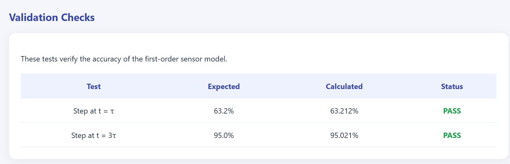
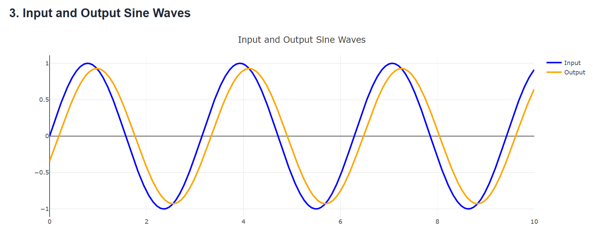
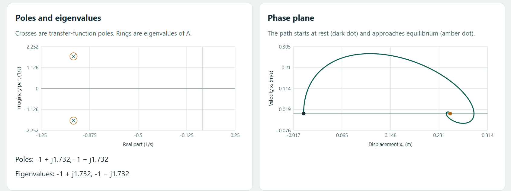
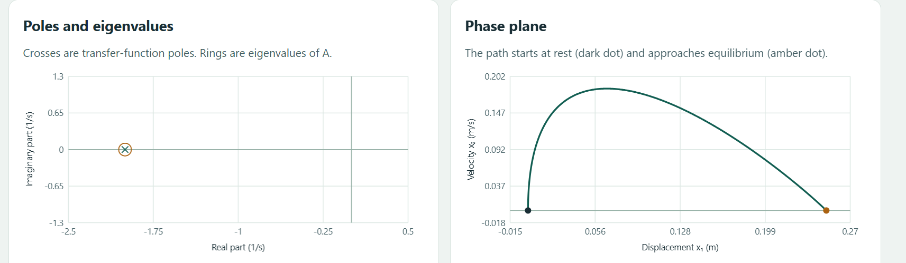
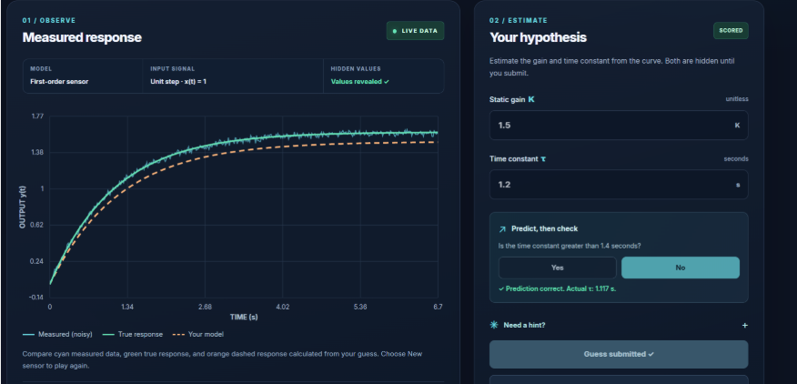
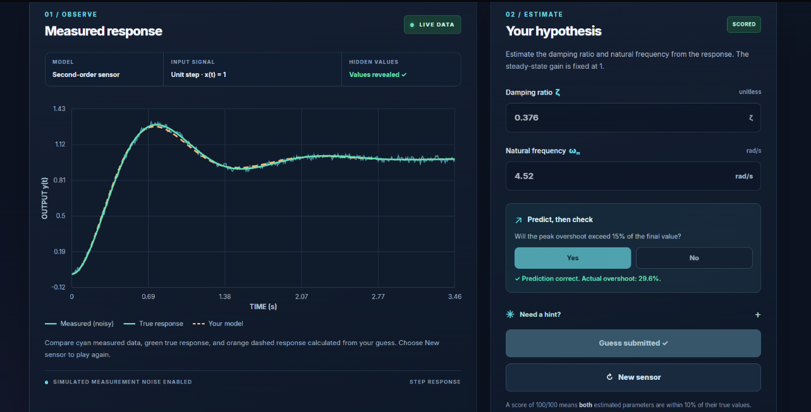

# Sparky — Dynamic Characteristics Interactive Toolkit

**ENCS4380 Interfacing Techniques · Homework 1**  
Birzeit University · Dr. Wasel Ghanem

Sparky is a browser-based toolkit for exploring the time and frequency responses of first- and second-order sensors. The first three modules let you change model parameters and see how the plots respond. The fourth gives you a noisy response and asks you to estimate the sensor parameters.

## Team and modules

| Module | Developer | Responsibilities|
| --- | --- | --- |
| [1 · First-order time response](HalaTarifi1230624_Module1/README.md) | Hala Tarifi (1230624) | Change gain and time constant. Compare step and ramp responses, measure ramp lag and steady-state error, and inspect the logarithmic error plot. |
| [2 · First-order frequency response](AseelNakhleh1230736_Module2/README.md) | Aseel Nakhleh (1230736) | Vary the time constant and input frequency. Compare input and output sine waves, inspect the Bode plots and cutoff, and calculate dynamic error. |
| [3 · Second-order response and state space](SamirHazboun1230807_module3/README.md) | Samir Hazboun (1230807) | Compare underdamped, critically damped, and overdamped responses. Measure rise time, peak time, overshoot, and settling time. Compare the poles with the state-matrix eigenvalues and view the phase plane. |
| [4 · Guess the Sensor](MohammadAbuadiyah_1220270_Module4/Mohammadabuadiyah_1220270_module4/README.md) | Mohammad Abuadiyah (1220270) | Estimate parameters from noisy step or sine responses. Use hints, compare the guessed and true curves, and track the score across rounds. |

## Run locally

1. Clone the repository or use **Code → Download ZIP** and extract it.
2. Open the module's HTML file in your browser. Keep its JavaScript and CSS files beside it.

| Module | Browser entry point |
| --- | --- |
| 1 | `HalaTarifi1230624_Module1/index.html` |
| 2 | `AseelNakhleh1230736_Module2/module2.html` |
| 3 | `SamirHazboun1230807_module3/index.html` |
| 4 | `MohammadAbuadiyah_1220270_Module4/Mohammadabuadiyah_1220270_module4/index.html` |

No build step is required. Modules that load Plotly from a CDN need an internet connection for the plots.

## Homework validation

Modules 1–3 display the expected values, calculated results, and pass/fail status in their validation sections.

| Check | Module | Expected result |
| --- | --- | --- |
| 1 · First-order step | 1 | 63.2% of the final value at t = τ and 95.0% at t = 3τ |
| 2 · Sine input with τ = 0.2 s and ω = 2 rad/s | 2 | Amplitude ratio ≈ 0.93 and phase lag ≈ 21.8° |
| 3 · At most 5% dynamic error up to 100 Hz | 2 | Maximum τ ≈ 0.52 ms and phase lag ≈ 9.3° at 50 Hz |
| 4 · Second-order step with ζ = 0.5 | 3 | 16.3% overshoot |
| 5 · Second-order step with ζ = 1 | 3 | 0% overshoot |
| 6 · State space with m = 1, b = 2, k = 4 | 3 | State-matrix eigenvalues and transfer-function poles both equal −1 ± j1.732 |

## Screenshots
**Module 1. First-Order Time Response**

**Developed by Hala Tarifi**

#### Step Response

#### Ramp Response

#### Error Fraction

The following validation checks verify the accuracy of the first-order sensor model:

- Step response at t = τ: Expected 63.2%.
- Step response at t = 3τ: Expected 95.0%.

Both validation checks passed successfully.

**Module 2. First-Order Frequency Response**
### Input and Output Sine Waves

### Bode Magnitude Plot

### Bode Phase Plot

**Module 3. Second-order response**
**Developed by Samir Hazboun**

### 1. Step Response Analysis

#### Underdamped System – Step Response and Overshoot

#### Critically Damped System – Step Response

#### Overdamped System – Step Response

### 2. State-Space Representation

#### Underdamped System – State-Space Model

#### Critically Damped System – State-Space Model

#### Overdamped System – State-Space Model

### 3. Poles, Eigenvalues, and Phase-Plane Analysis

#### Underdamped System – Complex Poles and Phase Plane

#### Critically Damped System – Repeated Real Poles and Phase Plane

#### Overdamped System – Distinct Real Poles and Phase Plane

**Module 4 · First-order step results**

**Module 4 · Second-order results**

## AI Assistance

Module 1: ChatGPT was used to explain concepts and assist with coding and debugging.

Module 2: ChatGPT helped with understanding concepts, coding, and testing.

Module 3: AI was used to help understand the concepts, check and test the module's behavior, and draft the README.

Module 4: AI tools assisted with understanding the concepts, implementing features, and testing the challenge.

README: AI assisted with organizing and drafting the repository documentation.
