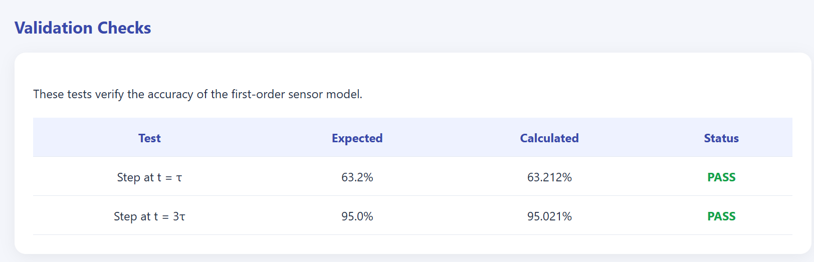
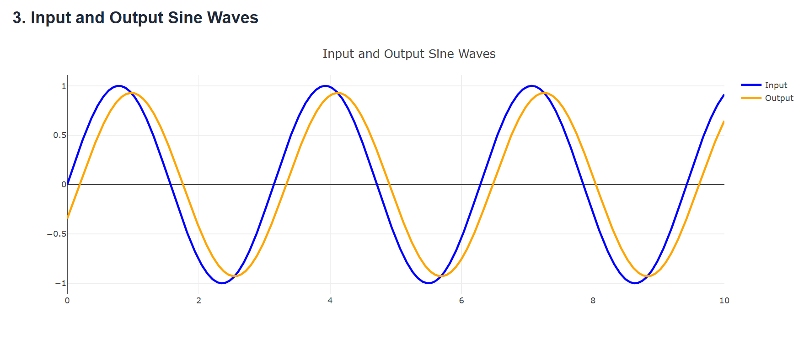
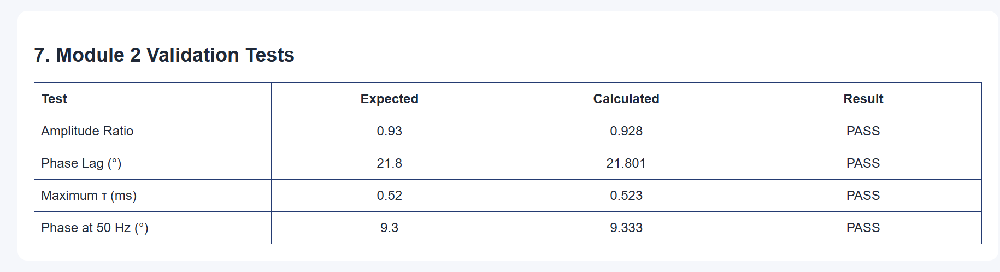
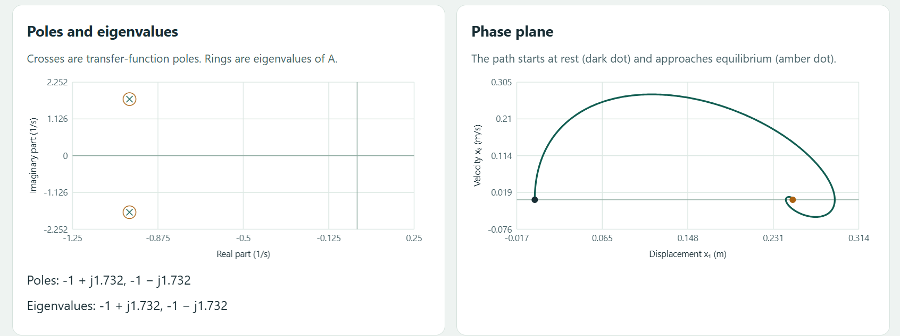
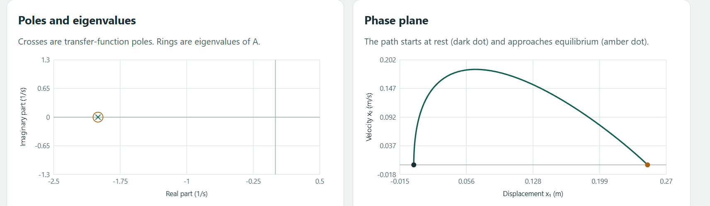
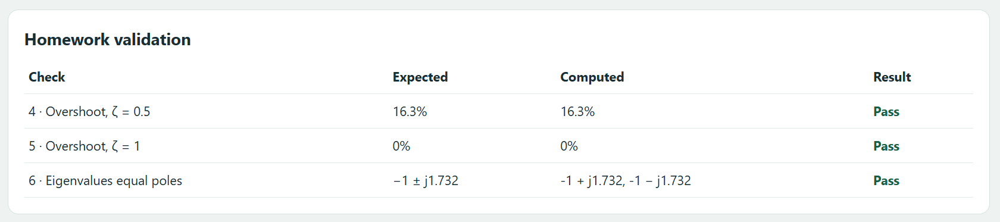
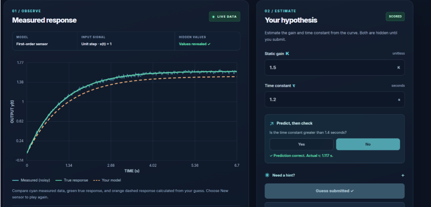
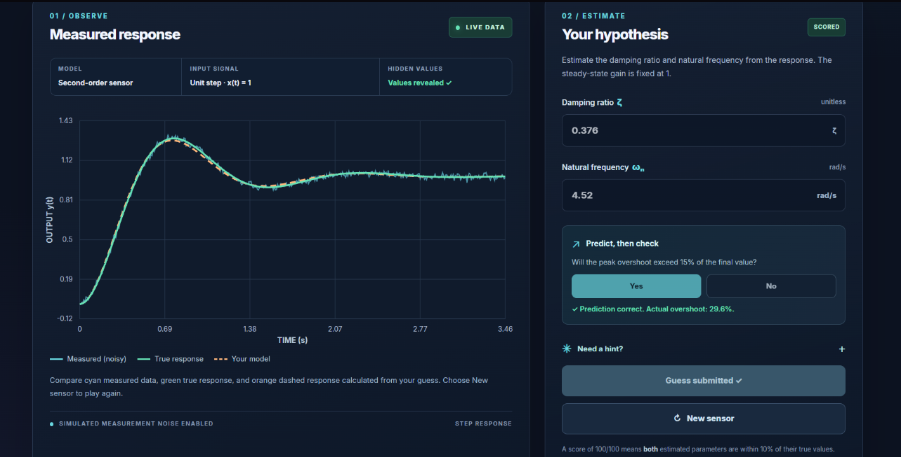

# Sparky — Dynamic Characteristics Interactive Toolkit

**ENCS4380 Interfacing Techniques · Homework 1**  
Birzeit University · Dr. Wasel Ghanem

Sparky is a browser-based toolkit for exploring the time and frequency responses of first- and second-order sensors. The first three modules let you change model parameters and see how the plots respond. The fourth gives you a noisy response and asks you to estimate the sensor parameters.

## Team and modules

| Module | Developer | Responsibilities|
| --- | --- | --- |
| [1 · First-order time response](HalaTarifi1230624_Module1/README.md) | Hala Tarifi (1230624) | Change gain and time constant. Compare step and ramp responses, measure ramp lag and steady-state error, and inspect the logarithmic error plot. |
| [2 · First-order frequency response](AseelNakhleh1230736_Module2/README.md) | Aseel Nakhleh (1230736) | Vary the time constant and input frequency. Compare input and output sine waves, inspect the Bode plots and cutoff, and calculate dynamic error. |
| [3 · Second-order response and state space](SamirHazboun1230807_module3/README.md) | Samir Hazboun (1230807) | Compare underdamped, critically damped, and overdamped responses. Measure rise time, peak time, overshoot, and settling time. Compare the poles with the state-matrix eigenvalues and view the phase plane. |
| [4 · Guess the Sensor](MohammadAbuadiyah_1220270_Module4/Mohammadabuadiyah_1220270_module4/README.md) | Mohammad Abuadiyah (1220270) | Estimate parameters from noisy step or sine responses. Use hints, compare the guessed and true curves, and track the score across rounds. |

## Run locally

1. Clone the repository or use **Code → Download ZIP** and extract it.
2. Open the module's HTML file in your browser. Keep its JavaScript and CSS files beside it.

| Module | Browser entry point |
| --- | --- |
| 1 | `HalaTarifi1230624_Module1/index.html` |
| 2 | `AseelNakhleh1230736_Module2/module2.html` |
| 3 | `SamirHazboun1230807_module3/index.html` |
| 4 | `MohammadAbuadiyah_1220270_Module4/Mohammadabuadiyah_1220270_module4/index.html` |

No build step is required. Modules that load Plotly from a CDN need an internet connection for the plots.

## Homework validation

Modules 1–3 display the expected values, calculated results, and pass/fail status in their validation sections.

| Check | Module | Expected result |
| --- | --- | --- |
| 1 · First-order step | 1 | 63.2% of the final value at t = τ and 95.0% at t = 3τ |
| 2 · Sine input with τ = 0.2 s and ω = 2 rad/s | 2 | Amplitude ratio ≈ 0.93 and phase lag ≈ 21.8° |
| 3 · At most 5% dynamic error up to 100 Hz | 2 | Maximum τ ≈ 0.52 ms and phase lag ≈ 9.3° at 50 Hz |
| 4 · Second-order step with ζ = 0.5 | 3 | 16.3% overshoot |
| 5 · Second-order step with ζ = 1 | 3 | 0% overshoot |
| 6 · State space with m = 1, b = 2, k = 4 | 3 | State-matrix eigenvalues and transfer-function poles both equal −1 ± j1.732 |

## Live Website

The Dynamic Characteristics Interactive Toolkit is hosted on GitHub Pages. The website provides access to all four interactive modules developed by Team Sparky.

**Website Link:** [https://aseelnakhleh.github.io/encs4380-dynamics-sparky/](https://aseelnakhleh.github.io/encs4380-dynamics-sparky/)

## Screenshots
**Module 1. First-Order Time Response**

**Developed by Hala Tarifi**

#### Step Response

#### Ramp Response

#### Error Fraction

The following validation checks verify the accuracy of the first-order sensor model:

- Step response at t = τ: Expected 63.2%.
- Step response at t = 3τ: Expected 95.0%.

Both validation checks passed successfully.

**Module 2. First-Order Frequency Response**
### Input and Output Sine Waves

### Bode Magnitude Plot

### Bode Phase Plot

The following validation checks verify the accuracy of the first-order frequency response calculations:

- Amplitude Ratio: Expected 0.93.
- Phase Lag: Expected 21.8°.
- Maximum Time Constant: Expected 0.52 ms.
- Phase Lag at 50 Hz: Expected 9.3°.

All four validation results passed successfully.

**Module 3. Second-order response**
**Developed by Samir Hazboun**

### 1. Step Response Analysis

#### Underdamped System – Step Response and Overshoot

#### Critically Damped System – Step Response

#### Overdamped System – Step Response

### 2. State-Space Representation

#### Underdamped System – State-Space Model

#### Critically Damped System – State-Space Model

#### Overdamped System – State-Space Model

### 3. Poles, Eigenvalues, and Phase-Plane Analysis

#### Underdamped System – Complex Poles and Phase Plane

#### Critically Damped System – Repeated Real Poles and Phase Plane

#### Overdamped System – Distinct Real Poles and Phase Plane

The following validation checks verify the accuracy of the second-order response and state-space model:

- Test 4: Overshoot at ζ = 0.5 — Expected 16.3%.
- Test 5: Overshoot at ζ = 1 — Expected 0%.
- Test 6: Eigenvalues equal poles — Expected −1 ± j1.732.

All three validation tests passed successfully.

**Module 4 · First-order step results**

**Module 4 · Second-order results**

## AI Assistance

Module 1: ChatGPT was used to explain concepts and assist with coding and debugging.

Module 2: ChatGPT helped with understanding concepts, coding, and testing.

Module 3: AI was used to help understand the concepts, check and test the module's behavior, and draft the README.

Module 4: AI tools assisted with understanding the concepts, implementing features, and testing the challenge.

README: AI assisted with organizing and drafting the repository documentation.

# Sparky — PID Control Toolkit

**ENCS4380 Interfacing Techniques · Homework 2**  
Birzeit University · Dr. Wasel Ghanem

The PID Control Toolkit is an extension of our Homework 1 project. It allows users to explore feedback control systems and understand how proportional, integral, and derivative gains affect system performance. The toolkit includes four interactive modules covering PID control, sensor delays, digital PID implementation, and controller tuning.

## Team and Modules

| Module | Developer | Responsibilities |
|---|---|---|
| P1 · PID Playground | Aseel Nakhleh (1230736) | Adjust PID gains, plant parameters, and setpoint. Analyze the system response, control signal, rise time, overshoot, settling time, and steady-state error. |
| P2 · Slow Sensor in the Loop | Hala Tarifi (1230624) | Study how sensor time constant affects feedback control. Compare actual and measured outputs and observe overshoot and oscillations. |
| P3 · Digital PID | Samir Hazboun (1230807) | Explore digital PID control, sampling time, and anti-windup. Generate Arduino code using the selected controller parameters. |
| P4 · Tuning Challenge | Mohammad Abuadiyah (1220270) | Tune PID parameters for randomly generated systems, meet performance requirements, and evaluate results using PASS/FAIL checks and scores. |

### Module Files

The planned folder structure is:

| Module | Browser Entry Point |
|---|---|
| P1 | `` |
| P2 | `` |
| P3 | `` |
| P4 | `` |

## Homework Validation

The following checks are required to verify the accuracy of the PID controller calculations.

| Check | Expected Result |
|---|---|
| 1 · P-only controller with K = 1, τ = 1 s, Kp = 9 | Closed-loop time constant = 0.1 s and steady-state error = 10% |
| 2 · PI controller with K = 1, τ = 1 s, Kp = 1, Ki = 1 | Natural frequency = 1 rad/s and damping ratio = 1 |
| 3 · PI controller with step input | Zero steady-state error under stable, unsaturated conditions |

Validation results will be displayed in the toolkit and documented after testing.

## Applying PID to Our Project

The toolkit also demonstrates how PID control can be applied to a real engineering system.

For our Micromouse project, PID control can be used to regulate motor speed. The motor model, controller parameters, and performance requirements will be selected using measured data.

The project application will include:

- Motor model and parameter values.
- Source of the model parameters.
- Selected performance requirements.
- Final PID gains.
- Simulated system response.
- Generated Arduino code.

## Live Website

The PID Control Toolkit will be integrated into the existing Team Sparky website under a new **Control** section.

**Website Link:** https://aseelnakhleh.github.io/encs4380-dynamics-sparky/

## AI Assistance

AI tools were used to help us understand PID control concepts and clarify some theoretical ideas related to the modules. The team members were responsible for developing and implementing their assigned modules.

